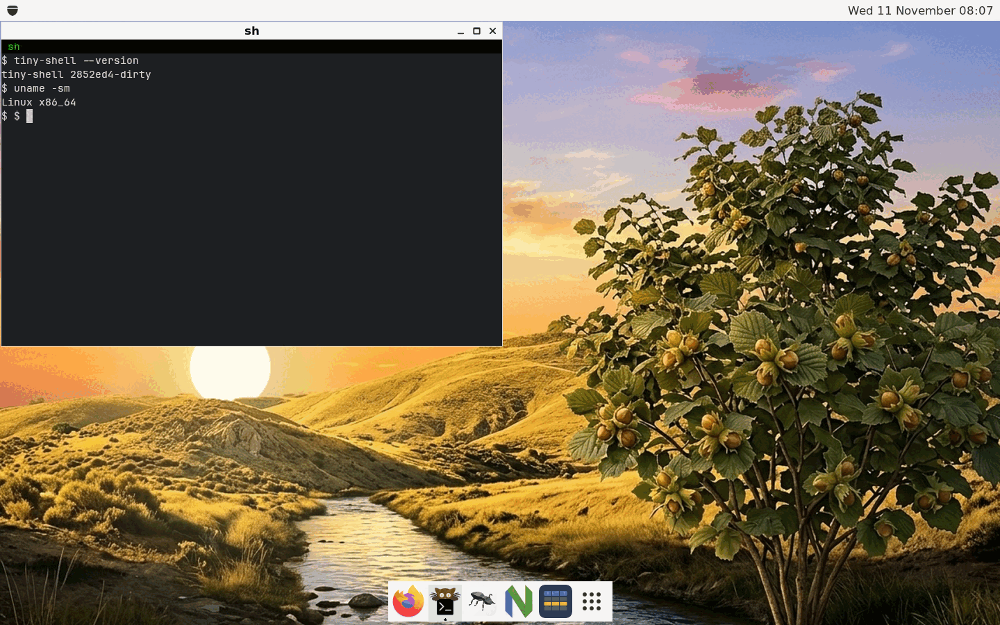

# tiny-shell

A very small and light window manager and desktop shell for X11, written
directly on top of Xlib.

*tiny-shell* is meant to be a tiny alternative to GNOME Shell: a reparenting
window manager with a panel, a dock, a menu and a launcher, in a few thousand
lines of C++ that depend on nothing but libX11 and a couple of light X
libraries. It targets embedded Linux systems that run Xorg, and it is also a
proof of concept: a way to learn Xlib properly and to squeeze out of it as much
as it can give.

> **Status:** a working prototype. It manages, decorates, moves, resizes,
> minimizes, maximizes and closes windows, and has a panel, a dock, a run
> dialog, an application launcher, a clock and a screen lock.



## Documentation

The documentation is in [doc/](doc/) and is published as a web site at
<https://ondratu.github.io/tiny-shell/>.

| Page | What is in it |
| ---- | ------------- |
| [Installation](doc/install.md) | requirements, build, install, trying it in a nested X server |
| [Using the shell](doc/usage.md) | the panel, the dock, the launcher, the window menu, the keys |
| [Configuration](doc/configuration.md) | the ini file, XSETTINGS, the tray, monitors, the command line |
| [Applications](doc/applications.md) | `tiny-settings`, `tiny-fonts`, `tiny-about`, `tiny-wallpaper` |
| [Screen lock](doc/lock.md) | `tiny-lock`: the password of the system, locking when idle, PAM, fingerprints, systems without PAM |
| [Features](doc/features.md) | everything that is implemented |
| [Comparison](doc/comparison.md) | tiny-shell next to Openbox, Blackbox, Fluxbox, LXDE, Xfce and GNOME |
| [Roadmap](doc/roadmap.md) | what is planned |
| [For developers](doc/developers/index.md) | the rules, the architecture, the tests |

## What it is not

- Not a desktop environment. No session manager and no desktop icons, and the
  only programs are small ones for the settings, the fonts, the wallpaper and the
  screen lock.
- Not a compositor. No transparency, shadows or animations.
- Not a Wayland compositor and not planned to be one. X11 on Xorg only.
- Not themable to the last pixel. There is one look, which can be scaled and
  configured within reason.

## Quick start

```sh
sudo apt install build-essential pkg-config \
    libx11-dev libxft-dev libxrender-dev libxext-dev libxrandr-dev \
    libxinerama-dev libfontconfig-dev

make                      # build/tiny-shell and the other programs
tools/run-xephyr.sh       # try it in a nested X server, the safest way
sudo make install         # into /usr/local
```

To use it as your window manager, run `exec tiny-shell` at the end of your
`~/.xinitrc`. More is in [Installation](doc/install.md).

## Contributing

Please read [CONTRIBUTING.md](CONTRIBUTING.md), which lists the core decisions
of the project; the details are in the [developer documentation](doc/developers/index.md).

## License

tiny-shell is released under the [BSD 2-Clause License](LICENSE).
