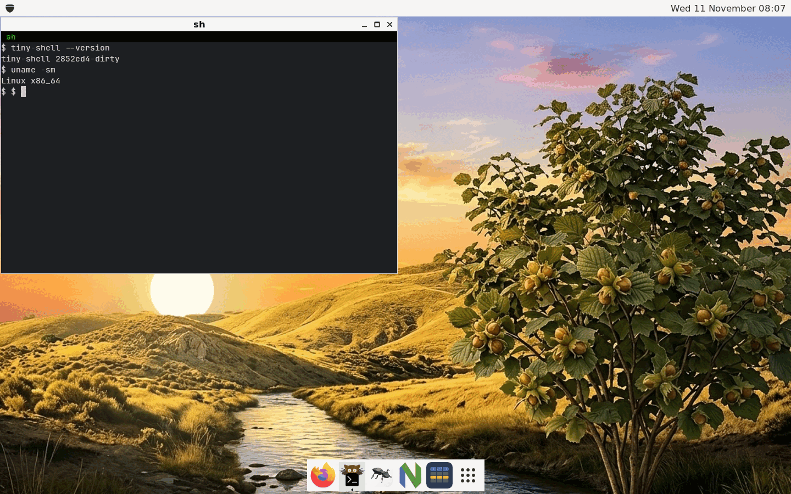

# tiny-shell

A very small and light window manager and desktop shell for X11, written
directly on top of Xlib.

*tiny-shell* is meant to be a tiny alternative to GNOME Shell: a reparenting
window manager with a panel, a dock, a menu and a launcher, in a few thousand
lines of C++ that depend on nothing but libX11 and a couple of light X
libraries. It targets embedded Linux systems that run Xorg, and it is also a
proof of concept: a way to learn Xlib properly and to squeeze out of it as much
as it can give.

**Status:** a working prototype. It manages, decorates, moves, resizes,
minimizes, maximizes and closes windows, and has a panel, a dock, a run
dialog, an application launcher, a clock and a screen lock. See the [roadmap](roadmap.md) for
what is planned.

## What it is

- A reparenting window manager with title bars, buttons and borders drawn by
  tiny-shell itself.
- A small shell around it: top panel with the main menu, a dock with the icons
  of running windows, a run dialog.
- A set of freedesktop.org standards implemented as faithfully as possible
  (ICCCM, EWMH, Desktop Entry, Icon Theme), so that ordinary applications just
  work.
- A tiny widget toolkit (`lib/`, the library `libtiny-widgets.a`), made of plain
  X windows and Xft text, loosely inspired by GTK. It exists to serve the shell,
  the settings and the font viewer (and later the Lua plugins of the panel), not
  to be reused: it knows nothing about window management.

## What it is not

- Not a desktop environment. No file manager, session manager or desktop icons
  (use an external tool such as idesk if you need them).
- Not a compositor. No transparency, shadows or animations.
- Not a Wayland compositor and not planned to be one. X11 on Xorg only.
- Not a replacement for a full GNOME or KDE session on a desktop computer.
- Not themable to the last pixel. There is one look, which can be scaled
  (`[theme] scale` in the configuration file) and configured within reason.

## Where to go next

- [Installation](install.md): build it, install it, try it in a nested X server.
- [Using the shell](usage.md): the panel, the dock, the launcher, the keys.
- [Configuration](configuration.md): the ini file and what it can change.
- [Applications](applications.md): the settings, the font viewer and the rest.
- [Features](features.md) and the [comparison](comparison.md) with Openbox,
  Blackbox, Fluxbox, LXDE, Xfce and GNOME.
- [Screenshots](screenshots.md), the [download](download.md) page and
  [more links](more.md).
- [For developers](developers/index.md): the rules of the project and the
  architecture.

## Technology

- Written in C++17 (without RTTI), built with GNU make; two static libraries,
  the widgets and the shell
- [Xlib](https://www.x.org/releases/current/doc/libX11/libX11/libX11.html), Xft
  (with fontconfig and FreeType, which Xft needs anyway), Xrender and Xext (the
  SYNC extension); nothing else is needed to run it
- Tests use [googletest](https://github.com/google/googletest) and Xvfb

## License

tiny-shell is released under the
[BSD 2-Clause License](https://github.com/ondratu/tiny-shell/blob/master/LICENSE).
