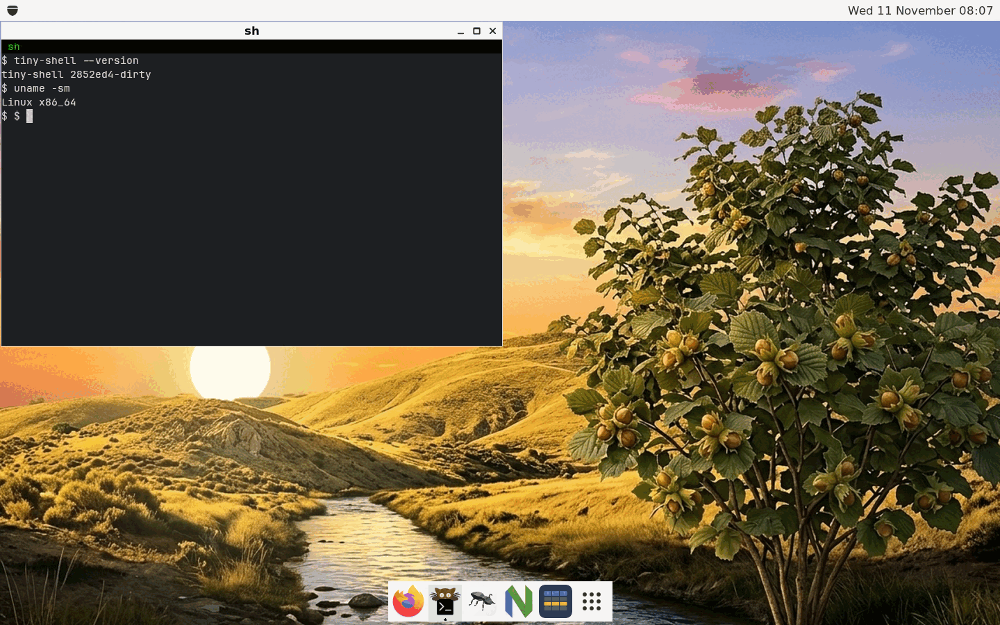
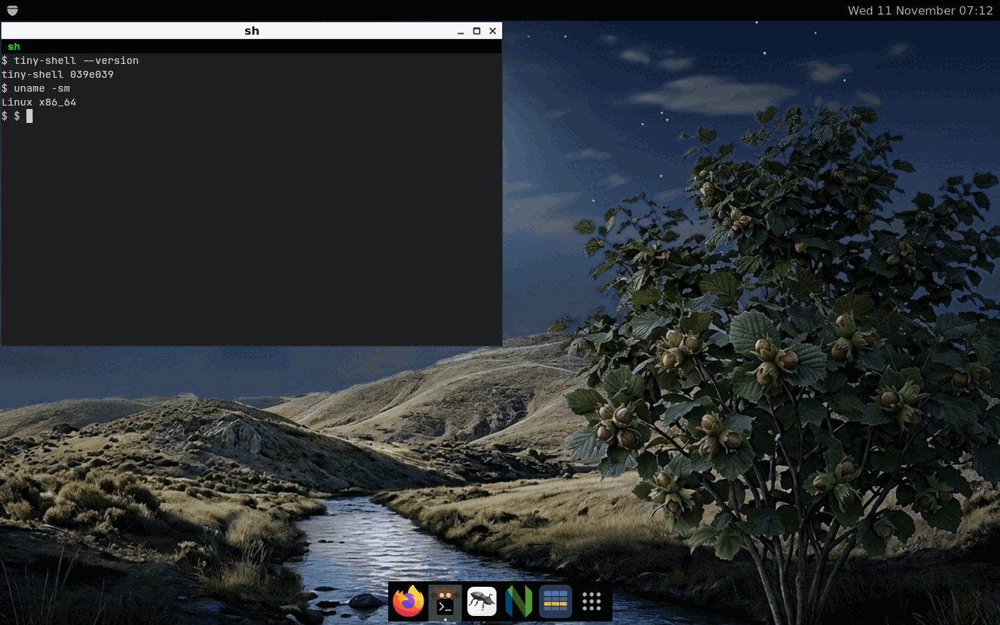
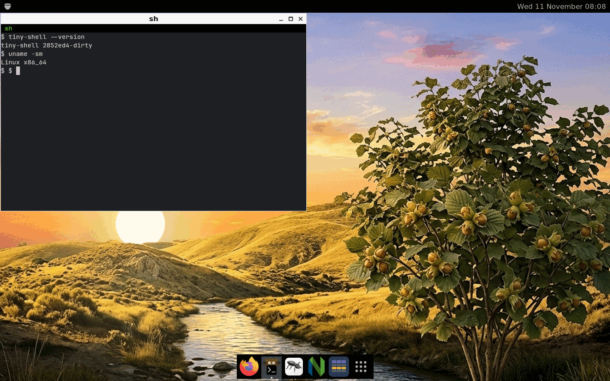
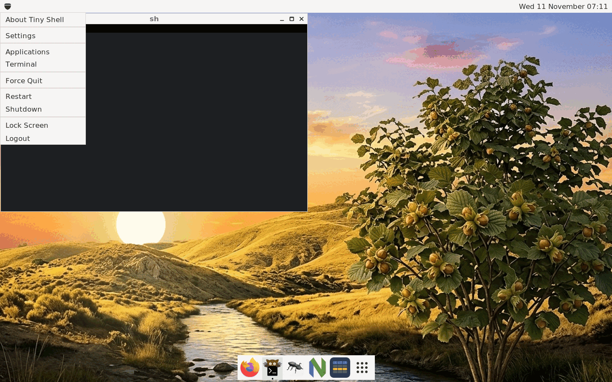
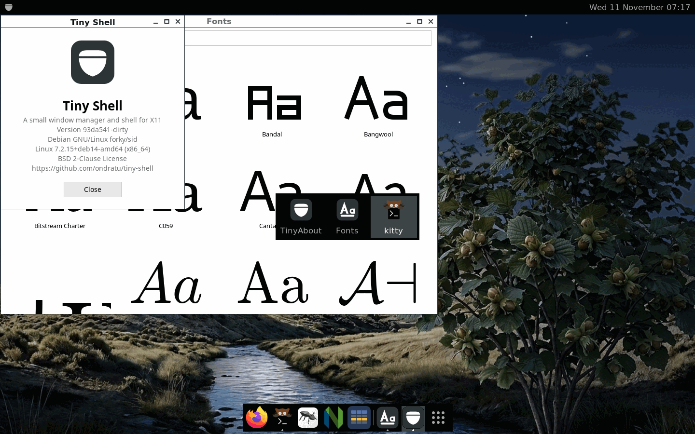
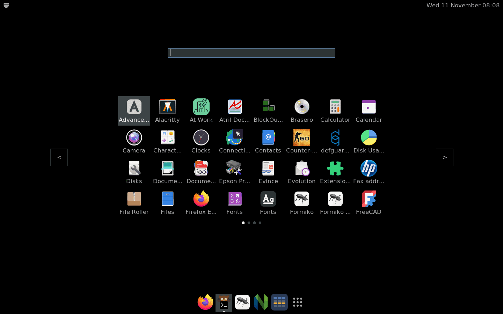
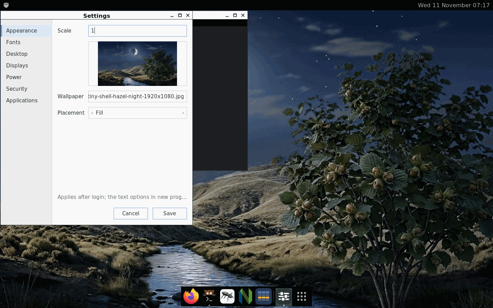
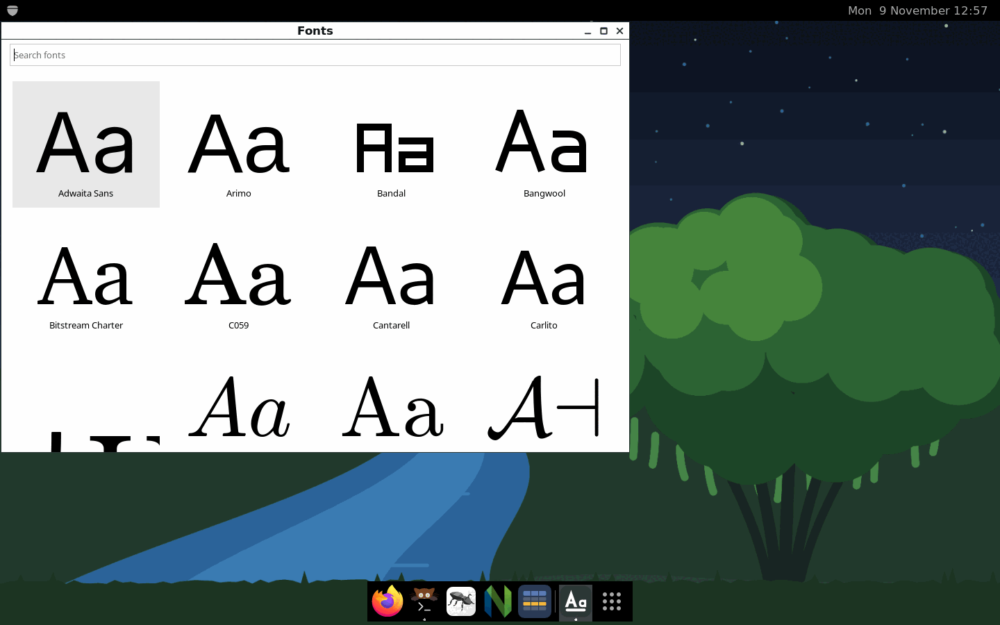

# Screenshots

Taken from tiny-shell running in a virtual X server. A click on a picture shows
it in full size.

## The desktop

The panel with the main menu and the clock, a window and the dock with the
icons of the running applications. The light style, which is the style of the
day, with the hazel by day as the wallpaper:

The dark style, which is the default, with the hazel by night as the wallpaper.
The title bars of the windows are dark too:

The panel and the dock have a style of their own (`[panel] style` and
`[dock] style`): here they are dark over the light style of the theme.

## The main menu

## The window switcher

Alt+Tab shows an icon and the name of every running application.

## The launcher

## Settings

## Fonts

